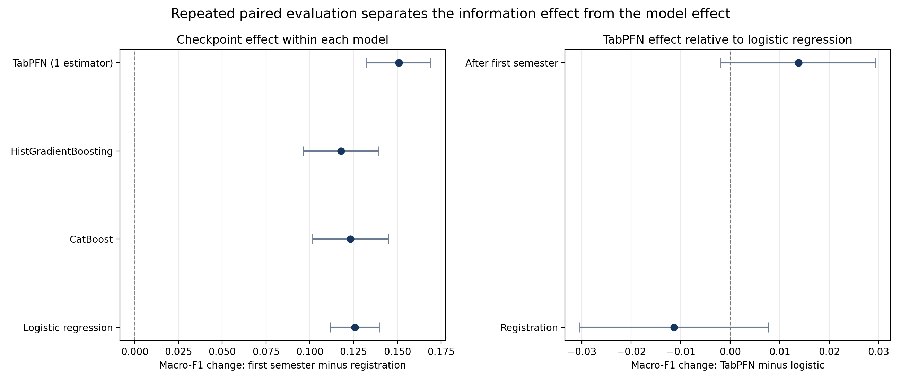
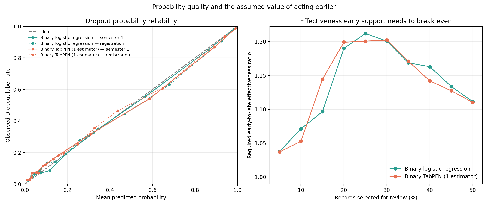
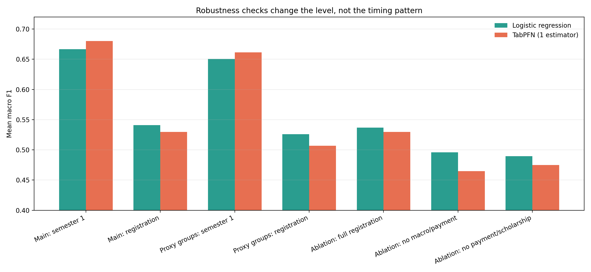

# When Better Predictions Arrive Later

*A repeated, paired evaluation of TabPFN, student-risk queues, and the price of waiting for more data*

Imagine a university retention team choosing between two folders.

The first can be opened at registration. It contains application details, demographics, prior qualifications, and administrative information already recorded by the institution. The second arrives after the first semester. It adds what happened in the classroom: units attempted, units approved, grades, and evaluations.

The second folder makes better predictions. That is not surprising. The difficult question is whether it arrives too late.

This case study tests that decision with a public higher-education dataset and four models: logistic regression, CatBoost, histogram gradient boosting, and the tabular foundation model TabPFN. The headline result is not a model victory. It is an information result:

> Across 25 paired test folds, moving from registration to first-semester information increased macro-F1 by 0.118 to 0.151, depending on the model. TabPFN's difference from logistic regression was much smaller, and its corrected interval crossed zero at both checkpoints.

In plain language: **when we predicted mattered more than which model we used**.

At 20% review capacity, the later TabPFN queue reached about 164 Dropout-labelled students per test fold, versus 137 at registration. The early queue would break even if early support were about 20% more effective—a decision threshold, not an estimated treatment effect. The evaluation therefore separates predictive accuracy from the assumed value of acting earlier.

## The case: predicting an outcome is not the same as helping a student

The data come from the UCI Machine Learning Repository's **Predict Students' Dropout and Academic Success** dataset. It contains 4,424 records from a Portuguese higher-education institution, 36 predictors, and a three-class outcome: Graduate, Dropout, or Enrolled. The associated data paper explains that the records combine enrollment information with academic performance at the end of the first and second semesters ([UCI dataset](https://archive.ics.uci.edu/dataset/697/predict+students+dropout+and+academic+success); [Realinho et al., 2022](https://doi.org/10.3390/data7110146)).

| Outcome | Records | Share |
|---|---:|---:|
| Graduate | 2,209 | 49.9% |
| Dropout | 1,421 | 32.1% |
| Enrolled | 794 | 17.9% |

The label deserves caution. A `Dropout` code is an administrative outcome, not a clinical diagnosis and not proof that an intervention was needed. The public table does not reveal why each student left and may combine departures with very different causes, including circumstances an advising programme cannot change. Throughout the operational analysis, I therefore use the awkward but accurate phrase **share of selected students with a Dropout label**, rather than calling it “precision” or “share who needed help.”

The project answers two different questions:

1. How well can we classify the source-defined three-class outcome?
2. If an advising team can review only a fraction of students, how many Dropout-labelled cases appear in the resulting queue?

The first is a modelling question. The second begins to resemble an operating decision. Neither estimates the effect of advising.

## Two prediction contracts

Before training anything, we need a feature-availability contract. A feature is eligible only if it would truly exist at the moment the score is produced.

| Checkpoint | Information allowed | Information excluded |
|---|---|---|
| Registration | application, demographics, prior education, administrative and economic fields | every first- and second-semester academic field |
| After semester one | registration fields plus first-semester attempts, approvals, grades and evaluations | every second-semester academic field |

This separation is more important than it looks. If a registration model sees a field updated after classes begin, its score describes hidden access to the future, not deployable performance.

Three fields require special suspicion: `Debtor`, `Tuition fees up to date`, and `Scholarship holder`. The public data do not document the exact time at which each value was frozen. I include them in the main registration contract, then remove them in a sensitivity analysis. That makes the main registration estimate an **upper-bound scenario** rather than an unquestioned deployment claim.

The complete feature lists and contract checks are encoded in the accompanying scripts. The first guardrail is deliberately simple:

```python
# Columns beginning with this prefix describe academic activity that occurs
# after registration. They must never enter the registration model.
SEMESTER_1_PREFIX = "Curricular units 1st sem"
SEMESTER_2_PREFIX = "Curricular units 2nd sem"

registration_columns = [
    column for column in X.columns
    if not column.startswith((SEMESTER_1_PREFIX, SEMESTER_2_PREFIX))
]

semester_1_columns = [
    column for column in X.columns
    if not column.startswith(SEMESTER_2_PREFIX)
]

# Fail loudly if the contract is violated. A silent leak is worse than a
# stopped analysis because it can produce a persuasive but unusable result.
assert not any(c.startswith(SEMESTER_1_PREFIX) for c in registration_columns)
assert not any(c.startswith(SEMESTER_2_PREFIX) for c in semester_1_columns)
```

## Evaluation: compare models on the same students

A single train/test split can make a small model difference look important simply because of which students happened to land in the test set. I replaced that design with **5-fold stratified cross-validation repeated five times**. Every model receives the same 25 train/test pairs at both checkpoints.

This pairing changes the unit of comparison. Instead of placing separate uncertainty bars around each model's average, we calculate the difference between two models on every shared fold. Because repeated cross-validation reuses observations in overlapping training sets, ordinary independent-sample intervals would be too optimistic. The reported approximate intervals use a Nadeau–Bengio-style corrected resampled approach ([2003](https://doi.org/10.1023/A:1024068626366)).

The main estimators are deliberately prespecified:

- Multinomial logistic regression provides a transparent linear baseline.
- CatBoost and histogram gradient boosting represent strong tree-based learners.
- TabPFN is a pretrained tabular foundation model that performs in-context prediction on a new table ([Hollmann et al., 2025](https://doi.org/10.1038/s41586-024-08328-6)).

The full code comments explain each preprocessing and evaluation choice. The core paired loop looks like this:

```python
rskf = RepeatedStratifiedKFold(
    n_splits=5,
    n_repeats=5,
    random_state=42,
)

rows = []
for fold_id, (train_idx, test_idx) in enumerate(rskf.split(X, y)):
    # The indices are created once. Every checkpoint and every model uses the
    # same held-out students, which makes within-fold differences meaningful.
    for checkpoint, columns in CHECKPOINT_COLUMNS.items():
        X_train = X.iloc[train_idx][columns]
        X_test = X.iloc[test_idx][columns]

        for model_name, make_model in MODEL_FACTORIES.items():
            model = make_model()
            probabilities = fit_predict_proba(
                model,
                X_train,
                y.iloc[train_idx],
                X_test,
            )

            # Save one row per model/checkpoint/fold. Keeping fold-level results
            # makes paired effects auditable instead of reconstructing them from
            # rounded averages later.
            rows.append({
                "fold": fold_id,
                "checkpoint": checkpoint,
                "model": model_name,
                **multiclass_scores(y.iloc[test_idx], probabilities),
            })
```

This evaluation is repeated rather than nested in the primary table. A separate five-fold audit tunes the conventional baselines using training-only inner cross-validation. Their mean macro-F1 remained tightly grouped: 0.530–0.536 at registration and 0.652–0.664 after semester one. A bounded ensemble sensitivity on the first deterministic outer fold compared TabPFN with one and four estimators. Four estimators improved registration macro-F1 from 0.523 to 0.543 on that fold, but reduced the semester-one value from 0.701 to 0.693. One fold cannot establish an ensemble advantage; it shows that this setting is not a guaranteed improvement. Keeping these audits separate prevents costly sensitivity checks from being confused with the prespecified 25-fold comparison.

## Result one: the checkpoint matters more than the model

| Checkpoint | Model | Macro-F1 | Multiclass log loss | Dropout AP* |
|---|---|---:|---:|---:|
| Registration | Logistic regression | 0.541 | 0.805 | 0.739 |
| Registration | CatBoost | 0.539 | 0.781 | 0.749 |
| Registration | HistGradientBoosting | **0.550** | 0.795 | 0.739 |
| Registration | TabPFN | 0.530 | **0.780** | **0.754** |
| After semester one | Logistic regression | 0.667 | 0.623 | 0.863 |
| After semester one | CatBoost | 0.663 | 0.607 | 0.863 |
| After semester one | HistGradientBoosting | 0.667 | 0.617 | 0.859 |
| After semester one | TabPFN | **0.680** | **0.587** | **0.869** |

*Dropout average precision is calculated one-vs-rest from the three-class probabilities. Values are means across 25 folds.*

TabPFN has the highest mean macro-F1 after semester one. But the paired comparison keeps that result in proportion.

| Paired macro-F1 difference | Mean difference | Approximate corrected 95% interval |
|---|---:|---:|
| TabPFN − logistic, registration | −0.011 | −0.030 to 0.008 |
| TabPFN − logistic, semester one | +0.014 | −0.002 to 0.029 |
| Semester one − registration, logistic | +0.126 | 0.112 to 0.140 |
| Semester one − registration, TabPFN | +0.151 | 0.133 to 0.169 |

The intervals for TabPFN versus logistic regression cross zero at both checkpoints. The checkpoint intervals do not come close to zero, and the later checkpoint wins on all 25 paired folds for every model.



The evidence supports a narrower conclusion:

> First-semester information produces a large and stable improvement. On this dataset, model choice produces smaller differences whose practical importance is uncertain.

That is useful news. It suggests that feature timing, evaluation design, and intervention timing deserve attention before a university invests heavily in a more complex estimator.

## Result two: later scores create a better queue

Macro-F1 gives equal weight to Graduate, Dropout, and Enrolled. That is useful for diagnosing a three-class model, but it does not match the retention team's workflow. For the queue analysis, I therefore train separate **binary Dropout-versus-rest models** in one five-fold pass and rank students by their held-out Dropout probability. This operational audit is separate from the 5×5 primary comparison.

At a 20% review capacity, each test fold contains about 885 students. The queue holds 177.

| Checkpoint | Binary model | Dropout labels reached | Queue recall | Selected share with Dropout label | AP | Brier score |
|---|---|---:|---:|---:|---:|---:|
| Registration | Logistic | 136.8 | 0.481 | 0.773 | 0.736 | 0.149 |
| Registration | TabPFN | 136.6 | 0.481 | 0.772 | 0.745 | 0.147 |
| Semester one | Logistic | 162.8 | 0.573 | 0.920 | 0.859 | 0.104 |
| Semester one | TabPFN | 163.8 | 0.576 | 0.925 | 0.866 | 0.104 |

The later queues are clearly more concentrated. Yet a queue produced after semester one also leaves fewer months in which support can be delivered. Whether those earlier months improve outcomes is an empirical question.

## Pricing the waiting decision

Let:

- $R_E$ be the number of Dropout-labelled students reached by the early queue;
- $R_L$ be the number reached by the later queue;
- $e_E$ and $e_L$ be the effectiveness of support delivered at those times;
- $c$ be the cost per reviewed student.

With equal queue sizes, the cost term cancels. The early queue is preferable when:

$$
R_E e_E > R_L e_L
$$

or equivalently:

$$
\frac{e_E}{e_L} > \frac{R_L}{R_E}.
$$

For TabPFN at 20% capacity:

$$
\frac{e_E}{e_L} > \frac{163.8}{136.6} \approx 1.20.
$$

For logistic regression, the corresponding ratio is about 1.19. So if support at registration is at least 19–20% more effective than the same support after semester one, the weaker early score can create more expected benefit.

This threshold assumes equal queue sizes and review costs, no differential harm from outreach, and a common benefit scale for every reached Dropout-labelled case apart from timing. It also treats effectiveness as comparable even though the two checkpoints can select different students. Relaxing those assumptions requires the supplied net-value grid or a local decision model.

This is a decision boundary, not evidence that early support really is 20% more effective. Field experiments show why effectiveness cannot simply be assumed: advising interventions differ in design, population, take-up, and effect ([Plak et al., 2021](https://doi.org/10.1111/hequ.12298); [Rust & Motz, 2025](https://doi.org/10.1016/j.iheduc.2025.101057)). The break-even analysis exposes the unknown quantity that a university must estimate locally.



The curve also shows that the required effectiveness ratio changes with queue capacity. Capacity is not a reporting detail; it is part of the policy.

## Robustness: what happens when the contract becomes stricter?

### A proxy-cohort stress test

The dataset has no explicit entry-year or cohort identifier. However, the three macroeconomic variables—unemployment, inflation, and GDP—form ten repeated value combinations. I use each combination as a **proxy context group**, assign entire groups to test folds with GroupKFold, and remove the macro variables from the feature matrix so the model cannot use the group key directly.

This is not genuine future-cohort validation. Students with the same economic tuple are not guaranteed to form one academic cohort. It is an imperfect stress test for dependence on repeated economic contexts.

| Analysis | Checkpoint | Logistic macro-F1 | TabPFN macro-F1 |
|---|---|---:|---:|
| Repeated random folds | Registration | 0.541 | 0.530 |
| Proxy-context GroupKFold | Registration | 0.526 | 0.507 |
| Repeated random folds | Semester one | 0.667 | 0.680 |
| Proxy-context GroupKFold | Semester one | 0.650 | 0.661 |

Mean performance was lower in this five-fold proxy-group stress test, although this is a descriptive comparison rather than a paired estimate against the 25-fold primary design. The ordering by checkpoint remained similar.

### An administrative-field ablation

The registration result is more fragile when timing-sensitive fields are removed.

| Registration feature contract | Logistic macro-F1 | TabPFN macro-F1 |
|---|---:|---:|
| Full registration contract | 0.537 | 0.530 |
| Without payment/scholarship fields | 0.490 | 0.475 |
| Without payment/scholarship and macro fields | 0.496 | 0.465 |

This drop is not a minor technical footnote. It says that the apparent strength of a registration system depends materially on fields whose freeze time must be verified before deployment.



## Subgroup diagnostics: evidence for questions, not a fairness certificate

A single global queue can distribute attention unevenly. Using each student's held-out semester-one TabPFN prediction from the five-fold binary audit and the same 20% overall capacity:

| Group | Selection rate | Queue recall |
|---|---:|---:|
| Women | 14.3% | 53.1% |
| Men | 30.5% | 62.6% |
| Scholarship holder | 4.1% | 29.1% |
| No scholarship | 25.3% | 60.8% |
| Age 19 or younger | 8.8% | 37.4% |
| Age 25 or older | 43.5% | 75.3% |

These gaps largely track different observed Dropout-label prevalence, but not perfectly.

These figures do not establish discrimination or fairness. The public table lacks the institutional and causal context needed for that conclusion. They do establish what a real audit must examine:

- false-negative rate and queue recall within each group;
- calibration, not only selection rate;
- whether a shared capacity threshold is appropriate;
- whether the label has the same meaning across groups;
- whether outreach itself creates unequal burdens, benefits, or stigma.

The package includes row-bootstrap intervals and a base-rate-proportional allocation reference so that readers can reproduce these diagnostics. The intervals condition on the fitted queue and do not propagate model-training or threshold uncertainty. They remain descriptive.

## Risk prediction is not intervention targeting

The model estimates something like:

$$
P(\text{Dropout label}=1 \mid X).
$$

The institution actually wants to know something closer to:

$$
E[Y(\text{support}) - Y(\text{no support}) \mid X],
$$

the conditional effect of offering support. These are different estimands. A student can be high-risk but unlikely to benefit from the available program. Another can be moderate-risk yet highly responsive to a small, timely intervention.

Observational risk models cannot resolve that distinction by themselves. Doing so requires a defined intervention, a defensible causal design, and preferably randomized or otherwise credible outcome evidence. Hernán and Robins provide a practical introduction to these target-trial and causal-inference ideas in *Causal Inference: What If* ([free online book](https://miguelhernan.org/whatifbook)).

Operationally, the score should be described as prioritizing cases for human review. It does not diagnose a student, prescribe an action, or identify who will benefit.

## What this project does not prove

This is an advanced evaluation of a public case study, not a deployment validation.

1. The records come from one institution and may not transport to another country, programme mix, or future cohort.
2. The proxy groups are derived from macroeconomic tuples, not verified cohort IDs.
3. Several administrative fields have uncertain freeze times.
4. The Dropout label may combine preventable and non-preventable departures.
5. Repeated-CV intervals address sampling variation within this table, not institutional drift.
6. The break-even ratio varies assumed intervention effectiveness; it does not estimate that effectiveness.
7. Subgroup diagnostics are incomplete without local policy, protected-attribute review, and intervention outcomes.
8. TabPFN results depend on software version, ensemble settings, hardware, and the restrictions of the fitted feature table.

These limitations do not erase the findings. They define the claims those findings can support.

## A deployment contract worth signing

Before a university turns this prototype into a workflow, it should be able to answer all of the following:

1. **Time:** Is every feature frozen and available at scoring time?
2. **Population:** Does the validation cohort match the students who will be scored?
3. **Queue:** What capacity can advisors actually review, and how quickly?
4. **Action:** What specific support follows selection?
5. **Evidence:** What is known about that support's effect at each checkpoint?
6. **Equity:** Who is selected, missed, burdened, and helped?
7. **Monitoring:** How will calibration, prevalence, capacity, and outcomes be tracked over time?
8. **Governance:** Can a student or advisor understand, question, and override the result?

The model is one component inside that contract. It is not the contract.

## The practical lesson

A higher score is not automatically a better intervention policy. TabPFN was competitive and achieved the best mean semester-one results, but once timing enters the decision, a university must evaluate the model, queue capacity, and support programme together.

The retention team should not ask only, “Which model scores highest?” It should ask:

> What can we know now, how many students can we reach, what action will follow, and how much value disappears while we wait for a better prediction?

A credible evaluation should make those quantities—and the assumptions connecting them—visible.

### Reproducibility note

The accompanying package contains the UCI data snapshot, pinned dependencies, the fully commented evaluation scripts, fold-level predictions and metrics, corrected paired intervals, robustness tables, publication figures, and commands for smoke and full runs. The primary run uses 5×5 repeated stratified cross-validation; the operational, grouped, ablation, and tuning audits are stored separately so their assumptions remain visible.

### Suggested Medium tags

Machine Learning · Education · Data Science · Tabular Data · Responsible AI
